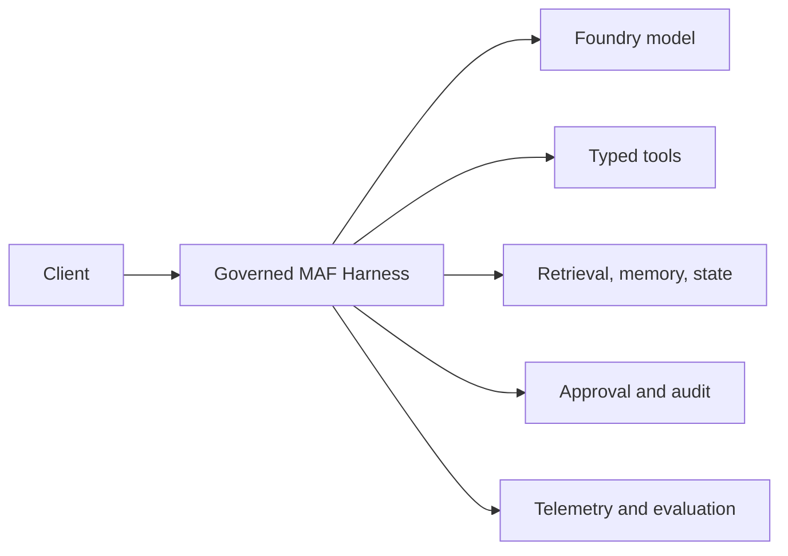

# AI Agent Harness

A reusable template for building governed, observable, and evaluable AI agents in a customer's
Azure tenant. It composes Microsoft Agent Framework (MAF) Harness for execution and Microsoft
Foundry for models, evaluation, and tracing instead of creating another agent runtime.

> **Current status:** Phase 1B is complete and Phase 1C is in progress. Deterministic MAF
> composition now proves model-selected registered tools remain behind the existing governance
> boundary, and a passwordless Foundry client factory plus live CLI path are available. Live
> Foundry validation, streaming conformance, and Agent Inspector setup remain before Phase 1C exits.

## Understand it in two minutes



The harness keeps customer-editable configuration separate from mandatory controls. Configuration
may select registered models, tools, and adapters, but cannot disable identity scope, tool
validation, act-tier approval, idempotency, audit correlation, telemetry privacy, or execution
ceilings.

## What works today

- A pinned Python 3.12 and `uv` development environment.
- Versioned schemas for harness configuration and normalized run events.
- Assistant, grounded-assistant, and action-agent example profiles.
- Framework-neutral contracts for model, retrieval, context, memory, state, approval, tools, audit,
  and telemetry.
- A deterministic local CLI with a tenant-scoped read tool, code-owned registry, governance checks,
  and append-only in-memory audit.
- A proposal tool and approval-gated sample action with checkpoints, expiry, exact proposal binding,
  idempotency, and uncertain-outcome protection.
- Architecture decisions for MAF, Foundry, Cosmos DB, Azure AI Search, deployment, and the reference
  model.
- Deterministic schema and contract checks that require no Azure connection.

The deterministic local runners intentionally have no model or Azure dependency. The Phase 1C MAF
tests use a scripted model client, while the live path uses Foundry through environment-resolved
configuration. The deployable Azure Dev environment follows in Phase 1D.

## Quick start

Prerequisites: Git and [`uv` 0.11.15](https://docs.astral.sh/uv/).

```powershell
git clone https://github.com/arun13go/AI-Agent-Harness.git
Set-Location "AI-Agent-Harness"
uv sync --frozen
uv run pytest
uv run pyright
uv run ruff check .
```

Expected result: the test suite passes, type checking reports no errors, and linting succeeds.
Azure access is not required for these checks.

Run the Phase 1A local read path:

```powershell
uv run agent-harness run `
  --profile config\profiles\assistant.yaml `
  --tenant tenant-0001 `
  --subject subject-0001 `
  --service api
```

The result is labeled as untrusted tool output, while the four audit events record only identifiers,
decisions, and lifecycle metadata.

Run the Phase 1B approved action demo:

```powershell
uv run agent-harness action-demo `
  --profile config\profiles\action-agent.yaml `
  --tenant tenant-0001 `
  --subject subject-0001 `
  --approver approver-0001 `
  --decision approved
```

Use `--decision denied` to verify that no action effect occurs.

Run the Phase 1C live MAF and Foundry path after setting the non-secret environment references:

```powershell
$env:FOUNDRY_PROJECT_ENDPOINT = "https://<account>.services.ai.azure.com/api/projects/<project>"
$env:AZURE_AI_MODEL_DEPLOYMENT_NAME = "<deployment-name>"

uv run agent-harness agent-run `
  --profile config\profiles\assistant.yaml `
  --tenant tenant-0001 `
  --subject subject-0001 `
  --prompt "Check the API service status."
```

Authentication uses `DefaultAzureCredential`; do not place credentials, endpoints, deployment
names, tenant IDs, or subscription IDs in committed profiles.

See [CONTRIBUTING.md](CONTRIBUTING.md) for the supported workflow and dependency-update policy.

## Profiles

A profile is a policy preset, not a separate executable. The current CLI supports these explicit
profile and command pairings:

| Profile | Current command | Status |
|---|---|---|
| Assistant | `run` | Deterministic read path; no Azure required |
| Assistant | `agent-run` | Live MAF and Foundry read path |
| Grounded assistant | None yet | Phase 2 will add retrieval, citations, and answerability |
| Action agent | `action-demo` | Deterministic proposal, approval, and one-time action path |

Unsupported pairings fail explicitly. The grounded profile cannot silently run without its
required retrieval and answerability controls.

Examples live under [`config/profiles/`](config/profiles/).

## Repository map

| Path | Purpose |
|---|---|
| [`src/agent_harness/core/`](src/agent_harness/core/) | Framework-neutral types and adapter contracts |
| [`src/agent_harness/adapters/`](src/agent_harness/adapters/) | Local storage and typed tool implementations |
| [`src/agent_harness/app/`](src/agent_harness/app/) | Local runner and CLI composition |
| [`config/`](config/) | Versioned schemas and safe example profiles |
| [`tests/`](tests/) | Deterministic schema and contract checks |
| [`docs/`](docs/) | Human documentation, decisions, delivery plan, and historical context |
| [`AGENTS.md`](AGENTS.md) | Always-on instructions for AI coding agents, not human onboarding |

Folders for evaluations and infrastructure are created only when their first working artifacts are
added.

## Where to go next

- **New to the repository:** follow the [documentation reading paths](docs/README.md).
- **New to the code:** follow the [developer code tour](docs/getting-started/code-tour.md).
- **Preparing a contribution:** read [CONTRIBUTING.md](CONTRIBUTING.md).
- **Understanding the design:** read the
  [reference architecture](docs/architecture/overview.md).
- **Checking current and next work:** read the
  [implementation plan](docs/delivery/implementation-plan.md).
- **Reviewing decisions:** browse the [ADRs](docs/decisions/).

The current executable milestone is Phase 1C:

```text
released MAF Harness
  -> Foundry model adapter
  -> registered tool selection
  -> existing read and action policy
  -> correlated model and tool spans
```

The deterministic composition and Foundry client factory are implemented. Live Foundry,
streaming, and Agent Inspector evidence are still required before Phase 1C is complete.

## Product boundary

Version 1.0 is cloud-first and Python-based. Azure Dev is the reference integration environment.
Local development supports editing and deterministic tests; it does not host model inference.
Foundry-specific behavior stays behind explicit adapters, and another runtime or provider must pass
the shared contracts rather than claiming configuration-only compatibility.

For scope details and authoritative architecture rules, use the
[documentation index](docs/README.md).

## License

This project is licensed under the [MIT License](LICENSE).
