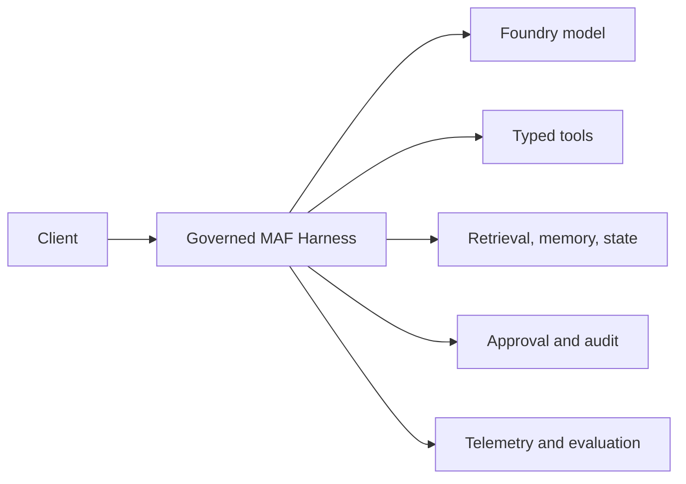

# AI Agent Harness

A reusable template for building governed, observable, and evaluable AI agents in a customer's
Azure tenant. It composes Microsoft Agent Framework (MAF) Harness for execution and Microsoft
Foundry for models, evaluation, and tracing instead of creating another agent runtime.

> **Current status:** Phase 0 is complete. Tooling, versioned schemas, typed adapter contracts, and
> deterministic checks are ready. The runnable agent and Azure infrastructure begin in Phase 1.

## Understand it in two minutes



The harness keeps customer-editable configuration separate from mandatory controls. Configuration
may select registered models, tools, and adapters, but cannot disable identity scope, tool
validation, act-tier approval, idempotency, audit correlation, telemetry privacy, or execution
ceilings.

## What works today

- A pinned Python 3.12 and `uv` development environment.
- Versioned schemas for harness configuration and normalized run events.
- Assistant, grounded-assistant, and action-agent example profiles.
- Framework-neutral contracts for model, retrieval, context, memory, state, approval, tools, audit,
  and telemetry.
- Architecture decisions for MAF, Foundry, Cosmos DB, Azure AI Search, deployment, and the reference
  model.
- Deterministic schema and contract checks that require no Azure connection.

There is not yet a runnable agent or deployable Azure environment. Those are Phase 1 deliverables.

## Quick start

Prerequisites: Git and [`uv` 0.11.15](https://docs.astral.sh/uv/).

```powershell
git clone https://github.com/arun13go/AI-Agent-Harness.git
Set-Location "AI-Agent-Harness"
uv sync --frozen
uv run pytest
uv run pyright
uv run ruff check .
```

Expected result: the test suite passes, type checking reports no errors, and linting succeeds.
Azure access is not required for these checks.

See [CONTRIBUTING.md](CONTRIBUTING.md) for the supported workflow and dependency-update policy.

## Profiles

| Profile | Use it when |
|---|---|
| Assistant | The model can complete a bounded task from supplied content, general reasoning, or approved tools |
| Grounded assistant | Answers must come from current authorized evidence with citations and an answerability check |
| Action agent | The agent may propose or perform consequential actions with checkpoints, approval, and idempotency |

Examples live under [`config/profiles/`](config/profiles/).

## Repository map

| Path | Purpose |
|---|---|
| [`src/agent_harness/core/`](src/agent_harness/core/) | Framework-neutral types and adapter contracts |
| [`config/`](config/) | Versioned schemas and safe example profiles |
| [`tests/`](tests/) | Deterministic schema and contract checks |
| [`docs/`](docs/) | Human documentation, decisions, delivery plan, and historical context |
| [`AGENTS.md`](AGENTS.md) | Always-on instructions for AI coding agents, not human onboarding |

Folders for runtime adapters, application entry points, evaluations, and infrastructure are created
only when their first working Phase 1 artifacts are added.

## Where to go next

- **New to the repository:** follow the [documentation reading paths](docs/README.md).
- **Preparing a contribution:** read [CONTRIBUTING.md](CONTRIBUTING.md).
- **Understanding the design:** read the
  [reference architecture](docs/architecture/overview.md).
- **Checking current and next work:** read the
  [implementation plan](docs/delivery/implementation-plan.md).
- **Reviewing decisions:** browse the [ADRs](docs/decisions/).

The next executable milestone is:

```text
validated profile
  -> identity and run context
  -> MAF composition
  -> typed read tool
  -> normalized events
  -> in-memory audit
  -> deterministic policy tests
```

## Product boundary

Version 1.0 is cloud-first and Python-based. Azure Dev is the reference integration environment.
Local development supports editing and deterministic tests; it does not host model inference.
Foundry-specific behavior stays behind explicit adapters, and another runtime or provider must pass
the shared contracts rather than claiming configuration-only compatibility.

For scope details and authoritative architecture rules, use the
[documentation index](docs/README.md).
