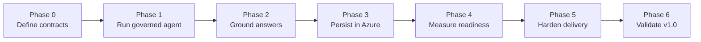
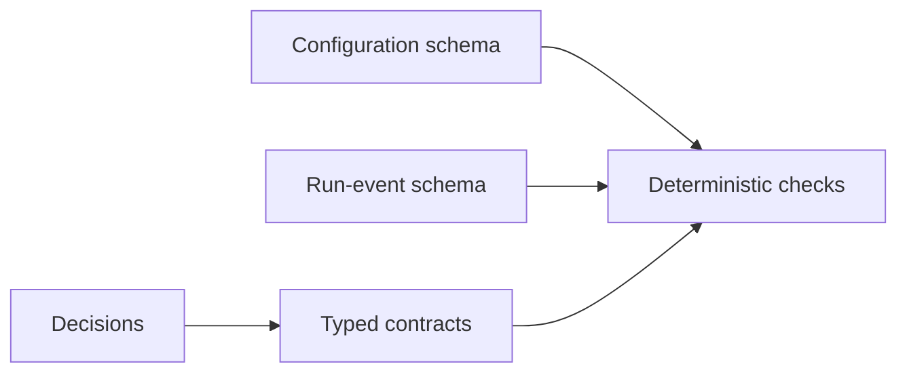
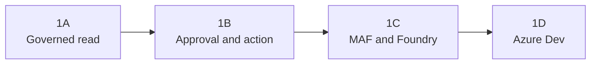
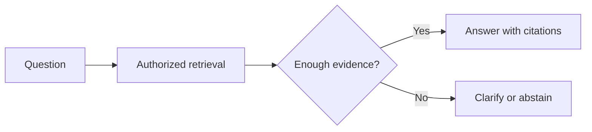
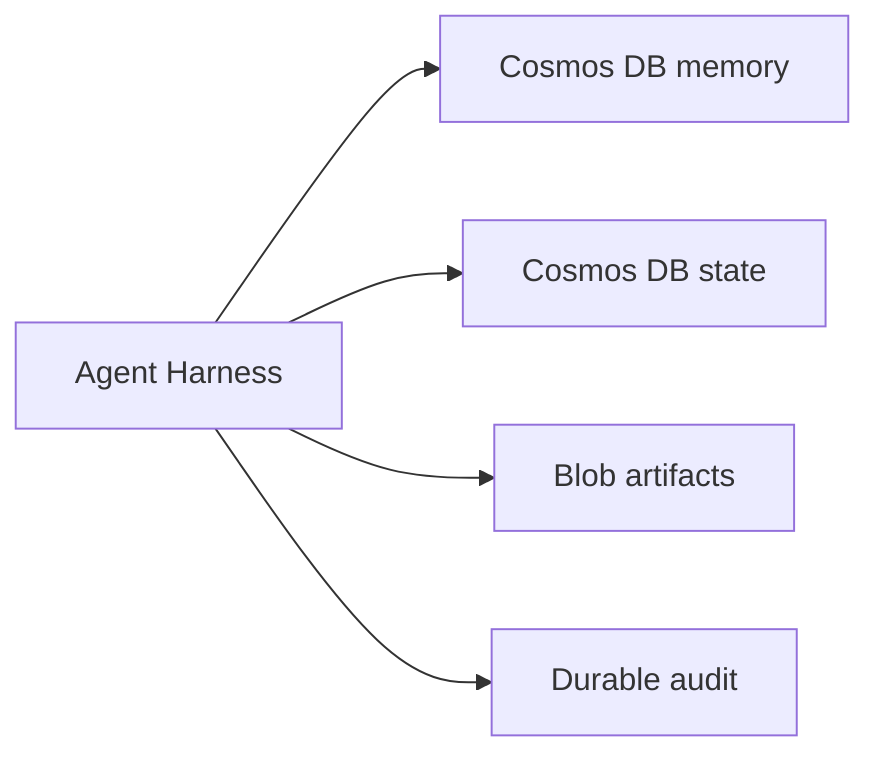
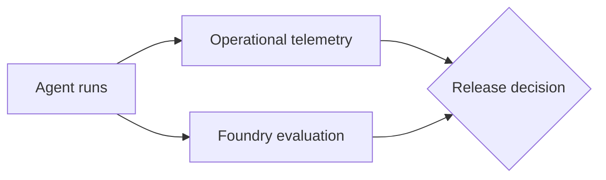
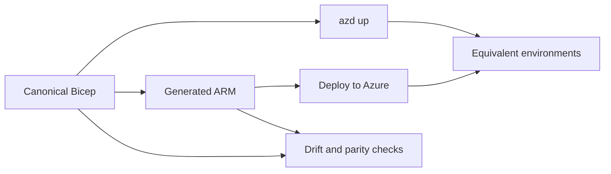
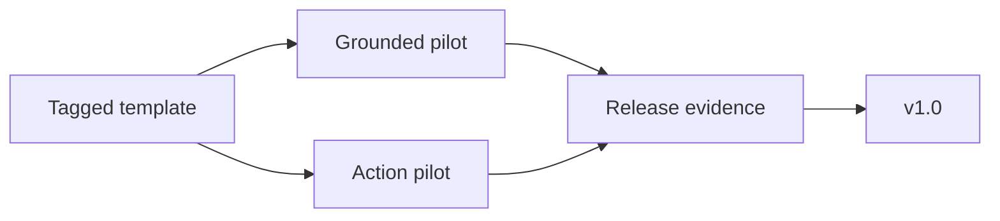

# Implementation Plan

> **Audience:** contributors and maintainers  
> **Status:** current and authoritative  
> **Purpose:** delivery order, current status, and completion evidence

This plan says **what ships when**. The [pattern catalogue](pattern-catalog.md) defines detailed
behavior, and the [adapter contract guide](../architecture/adapter-contracts.md) defines shared
adapter expectations.

## Delivery Rules

- Build thin, testable increments.
- Keep local policy tests independent of Azure.
- Use released MAF capabilities instead of creating another agent runtime.
- Record architecture changes in ADRs.
- Mark a phase complete only when its exit evidence passes.

## Status

| Phase | Outcome | Status |
|---|---|---|
| 0 | Tooling, schemas, contracts, and decisions | Complete |
| 1A | Governance and read path foundation | Complete |
| 1B | Approval and action lifecycle | Complete |
| 1C | MAF and Foundry runtime integration | Complete (approved live-test model exception) |
| 1D | Azure Dev deployment | Complete |
| 2 | Grounded-assistant profile | In progress (local path runnable; Azure AI Search and hosting open) |
| 3 | Durable Azure adapters | Not started |
| 4 | Evaluation and operations | Not started |
| 5 | Deployment and CI hardening | Not started |
| 6 | Pilots and v1.0 release | Not started |

## Architecture Evolution

Each phase adds one capability layer. Detailed behavior remains authoritative in the
[pattern catalogue](pattern-catalog.md).

### Phase 0: Define the Rules

Phase 0 defines and validates the boundaries before runtime implementation.

### Phase 1: Run the First Governed Agent

Phase 1 proves the local governance lifecycle, then connects and deploys it without changing the
policy envelope.

### Phase 2: Ground Answers

Phase 2 adds evidence retrieval, citations, freshness, and safe insufficient-evidence routes.

### Phase 3: Persist in Azure

Phase 3 replaces in-memory adapters without changing agent policy.

### Phase 4: Measure Readiness

Phase 4 combines service health and agent-quality evidence into one release decision.

### Phase 5: Harden Delivery

Phase 5 makes both deployment paths repeatable and rejects infrastructure drift.

### Phase 6: Validate v1.0

Phase 6 proves that different customer scenarios retain the same governance and evaluation
controls. The complete target is shown in the
[reference architecture](../architecture/overview.md).

## Phase 0: Foundation

Phase 0 established:

- Python 3.12, pinned dependencies, `uv.lock`, and contributor setup.
- Versioned configuration and run-event schemas with three example profiles.
- Framework-neutral types, adapter protocols, and conformance-test design.
- ADRs for MAF, Azure Dev, deployment, state, memory, retrieval, and the reference model.

**Evidence:** dependency setup, schema and contract tests, Pyright, Ruff, and lock validation pass.

## Phase 1: Governed Agent End-to-End Foundation

**Goal:** prove a governed read path and approval-gated action path, compose them through MAF and
Foundry, and deploy the same minimal application to Azure Dev.

### Phase 1A: Governance and Read Path Foundation

**Build**

- Validated YAML configuration and a code-owned registry.
- Tenant, subject, run, trace, permission, and deadline context.
- One typed read tool, execution ceilings, normalized errors, and an in-memory audit sink.
- A local CLI and deterministic policy tests.

**Pattern focus:** [MEM-01](pattern-catalog.md#mem-01),
[STATE-01](pattern-catalog.md#state-01), [SEC-02](pattern-catalog.md#sec-02) to
[SEC-04](pattern-catalog.md#sec-04), [SEC-06](pattern-catalog.md#sec-06),
[POL-01](pattern-catalog.md#pol-01) to [POL-03](pattern-catalog.md#pol-03),
[TOOL-01](pattern-catalog.md#tool-01), [TOOL-04](pattern-catalog.md#tool-04),
[EVAL-01](pattern-catalog.md#eval-01), [OBS-04](pattern-catalog.md#obs-04), and
[OBS-05](pattern-catalog.md#obs-05).

**Exit:** the local read path succeeds; unknown or unauthorized tools fail; identity reaches every
tool and event; audit records contain no prohibited payload; Azure is not required.

**Evidence:** strict profile loading, registry and policy tests, tenant-scoped read execution, safe
four-event audit lifecycle, local CLI, Pyright, Ruff, and deterministic tests pass without Azure.

### Phase 1B: Approval and Action Lifecycle

**Build**

- One proposal tool and one deterministic sample action.
- In-memory run state, checkpoint, approval, artifact handle, and idempotency ledger.
- Approval, denial, expiry, resume, replay, and partial-failure tests.

**Pattern focus:** [STATE-02](pattern-catalog.md#state-02) to
[STATE-05](pattern-catalog.md#state-05), [POL-04](pattern-catalog.md#pol-04),
[POL-05](pattern-catalog.md#pol-05), [POL-07](pattern-catalog.md#pol-07),
[TOOL-02](pattern-catalog.md#tool-02), and [TOOL-03](pattern-catalog.md#tool-03).

**Exit:** an action cannot run before approval; denial and expiry block it; approval resumes once;
replay does not repeat the effect.

**Evidence:** proposal and act-tier tools, in-memory lifecycle adapters, approval-bound resume,
atomic idempotency and audit sequencing, local action CLI, and deterministic denial, expiry,
cross-tenant, mutation, replay, concurrency, and uncertain-outcome tests pass without Azure.

### Phase 1C: MAF and Foundry Runtime Integration

**Build**

- Released MAF Harness composition around the Phase 1A and 1B policy envelope.
- Foundry model adapter with streaming, usage, cancellation, and normalized provider errors.
- Bounded conversation history, source labels, and tracing.

**Pattern focus:** [MEM-02](pattern-catalog.md#mem-02),
[CTX-01](pattern-catalog.md#ctx-01), [CTX-02](pattern-catalog.md#ctx-02),
[CTX-05](pattern-catalog.md#ctx-05), and [OBS-01](pattern-catalog.md#obs-01).

**Exit:** the reference model selects a registered tool through MAF; governance remains code-owned;
model and tool spans share run correlation.

**Evidence (16 October 2026):** the live passwordless CLI selected `get_service_status`, returned
the sample API's healthy status, emitted six audit events, and produced model, tool, and agent spans
sharing one trace ID. The full local suite passed: 56 tests, Pyright, and Ruff. Metadata-only trace
evidence is retained under ignored `.local/logs/phase1c-live-trace.json`.

**Approved exit exception:** the proof used `gpt-5-mini` version `2025-08-07`, GlobalStandard
capacity 1, because quota for the `gpt-5.4-mini` reference baseline was unavailable. This closes the
runtime integration milestone, not reference-model certification. Repeat the live proof with the
[reference model](../decisions/0008-gpt-5-4-mini-reference-model.md) when quota is available.
Application Insights export and managed-identity hosting remain Phase 1D work.

### Phase 1D: Azure Dev Deployment

**Build**

- Preflight for tools, authentication, providers, model availability, and quota.
- Minimal `azure.yaml` and canonical Bicep for hosting, managed identity, Foundry, RBAC, and
  Application Insights.
- Supported Responses HTTP host plus VS Code Agent Inspector configuration and evidence.
- An initial generated **Deploy to Azure** artifact plus cloud smoke and trace checks.

**Pattern focus:** [SEC-01](pattern-catalog.md#sec-01),
[SEC-05](pattern-catalog.md#sec-05), [SEC-07](pattern-catalog.md#sec-07),
[OBS-01](pattern-catalog.md#obs-01), and [OBS-02](pattern-catalog.md#obs-02).

**Exit:** both deployment entry points create the minimal Azure Dev topology; one managed-identity
request completes with correlated traces; local policy tests still require no Azure connection.

**Increment evidence (20 October 2026):** azd, Foundry extensions, and Azure sign-in preflight pass.
The released Responses server now wraps `MafAgentExecutor`; HTTP tests cover registered tools,
concurrent identity isolation, cross-tenant denial, strict input, JSON/SSE output, cancellation audit,
and sanitized provider failures. A real loopback socket returned healthy readiness and a completed
governed sample-tool response. Root VS Code debug/Inspector wiring is present.
Validation passes: 84 deterministic tests, Pyright with zero errors, Ruff lint/format checks,
documentation links, public-only lock consistency, and `git diff --check`.

**Identity increment (20 October 2026):** the hosted factory now enforces a single platform tenant,
an explicit bounded user allowlist, hashed harness subjects, and unambiguous platform headers.
Client-provided tenant and subject claims cannot override that binding. The local authenticator
refuses hosted execution. Tests exercise the adapter and its full HTTP/tool/audit composition;
live ingress authenticity is not yet proven. See
[ADR 0011](../decisions/0011-single-tenant-foundry-ingress-identity.md).

**Container increment (20 October 2026):** the operator selected container deployment to Foundry
Hosted Agents while retaining Python 3.12. A guarded hosted entry point and released MAF middleware
forward the SDK platform call ID per model request without mutating shared client headers.
Concurrent JSON/streaming transport tests and HTTP-to-model tests preserve caller isolation;
hosted credentials exclude developer and client-secret fallbacks. The Dockerfile installs frozen
production dependencies and runs non-root. Canonical Bicep and its generated ARM artifact prepare
a dedicated Basic registry, registry-scoped project image-pull permission, and a Foundry connection
without reprovisioning the existing project/model. See the [Azure Dev guide](../getting-started/azure-dev.md).

**Azure container evidence (20 October 2026):** registry-only azd provisioning succeeded in the
operator-selected existing project resource group. Live checks confirm Basic SKU, disabled admin
credentials/anonymous pull, the Entra registry connection, and registry-scoped project `AcrPull`.
ACR remote build installed the frozen production dependencies and pushed the image successfully.
A separate digest-pinned ACR run proved UID 10001, fail-closed hosted startup without platform
configuration, loopback readiness, and denial of instruction overrides without model access.
129 deterministic tests, Pyright, Ruff, Bicep compilation, server-side ARM validation, azd preview,
and local doctor checks pass. An image smoke test is not a Foundry-hosted identity proof.

**Current Phase 1D state:** hosted agent v7 is active and serves production; JSON, SSE, tool calls and
metadata-only cloud traces are verified. Unauthenticated (401) and instruction-override (400)
requests are rejected. A local Inspector request is operator-confirmed. The account is public
(`publicNetworkAccess=Enabled`), not network-isolated. The agent is a Foundry data-plane resource,
not a native ARM resource, so registration happens outside ARM
([ADR 0016](../decisions/0016-registration-outside-deployment-scripts.md); the ADR 0015 bridge stays
experimental).

**Candidate release evidence (28-29 October 2026):** the endpoint was pinned to v4 before `azd deploy`
(default routing is `@latest`, so a new version would otherwise take traffic immediately). v5
(identical configuration, rebuilt image) could not be smoke-tested because the strict host rejected
the platform `agent_session_id`; the host now accepts and strips only that routing field, with tests
that `conversation`, stored state and overrides stay rejected. v6 passed JSON and SSE through a
version-bound session with connected, payload-free traces, then was promoted at 100% and passed the
same checks on the production path. Streaming sent immediately after another request failed with
`model_provider_error` and passed after a pause. The model deployment (`gpt-5-mini`, GlobalStandard)
had capacity 1, i.e. 1 request and 1,000 tokens per 60 seconds, while one governed tool request
makes two model calls and uses roughly 650-840 tokens. With operator approval its capacity was raised
to 10 (10 requests and 10,000 tokens per minute; model, version, content filter and upgrade policy
unchanged), after which four consecutive production requests (JSON, SSE, JSON, SSE) all completed,
confirming the cause. The provider body is not logged, by design. 230 deterministic tests, Ruff and
Pyright pass.

**Authorization evidence (29 October 2026):** a temporary service principal in the project's tenant
with zero role assignments obtained a token and received 403 from the Foundry endpoint for JSON and
streaming requests. No `harness.http` span was recorded, so the platform rejected it before the
container. The principal and its secret were deleted (verified through Graph). Operator credentials
and tenant policy were not changed. This closes the unauthorized-principal gate; it does not by
itself prove full ingress acceptance (no separate direct-container ingress target was identified).

**Ingress and parity evidence (29 October 2026):** read-only probes of the production endpoint found
no way in other than the platform-owned, Entra-authenticated agent endpoint. No credential: 401; an
`api-key` header (local auth is disabled): 401; a malformed bearer token: 403; a roleless in-tenant
principal: 403. With a valid token, only `POST /responses` reaches the harness: other paths, the
`invocations` and `a2a` protocols (not enabled) and the project-level OpenAI route (hosted agents
"can only be called through the agent endpoint") are rejected, and `GET` on the responses route
returns an empty list because the stateless host stores nothing. A forged `x-ms-user-identity`
header is rejected (403, fail closed); other forged identity headers do not change the outcome. No
direct-container ingress exists in the project or version definition (compute is platform
managed). Caveats: the account is public (`publicNetworkAccess=Enabled`), so network isolation is a
Phase 5 production overlay, and the subject binding is verified by rejection, not by reading
telemetry (it is metadata-only by design). For parity, `infra/main.json` is published at its public
raw URL (identical hash), the README button targets it (a test pins the URL), and a read-only
`what-if` of that artifact against the `azd`-provisioned environment targets the same registry,
connection and role assignment; its differences were service-populated defaults.

**Promotion and live parity evidence (3 November 2026):** a fresh version-bound governed tool
request completed successfully against v7. The endpoint selector was then changed to v7 at 100%;
the production path returned a completed healthy service-status response. With explicit operator
approval, the published subscription-scope ARM template deployed successfully against the same
Azure Dev environment. All eight infrastructure outputs matched the azd environment, the
registration bridge remained disabled, the existing Basic ACR retained disabled admin and
anonymous access, the project retained one registry-scoped `AcrPull` assignment, and the
post-deployment governed production smoke passed. The loopback authenticator remains local-only
([ADR 0010](../decisions/0010-stateless-governed-responses-host.md)).

### Phase 1 Boundary

Phase 1 uses in-memory state, memory, artifacts, approval, and audit. It excludes:

- Retrieval, citations, answerability, and advanced context policy — Phase 2.
- Cosmos DB, Blob Storage, and durable Azure adapters — Phase 3.
- Production evaluation, dashboards, and outcome scorecards — Phase 4.
- Full deployment parity, CI federation, private networking, and production overlays — Phase 5.

## Later Phases

| Phase | Deliverable | Exit evidence |
|---|---|---|
| 2: Grounding and context | Azure AI Search ingestion and retrieval, multi-format ingestion (Word and PDF), citations, freshness, compaction, episodic-memory policy, and answerability routes | Weak, stale, conflicting, and sufficient evidence follow the correct route; Word and PDF sources chunk with the same identity, scope and safety rules as Markdown |
| 3: Azure reference adapters | Cosmos DB memory and run state, Blob artifacts, Azure cache and audit, retention, and Application Insights export | In-memory and Azure adapters pass the same isolation, concurrency, expiry, deletion, and replay tests |
| 4: Evaluation and operations | Versioned datasets, deterministic and Foundry evaluators, operational SLOs, outcome thresholds, and regression comparison | One go-live report covers policy, quality, safety, latency, cost, and telemetry |
| 5: Deployment and CI hardening | Modular Bicep, workload-identity CI, preflight, cleanup, production guidance, generated ARM, and drift checks | Both deployment paths pass clean-resource-group tests and CI rejects drift |
| 6: Pilots and release | One grounded pilot, one action pilot, tightened defaults, migration guidance, and release evidence | Both pilots deploy from one tag and preserve mandatory controls |

### Current Phase 2 Increment

The first deterministic grounding slice is implemented locally. Framework-neutral contracts now
carry tenant scope, authorization labels, retrieval time, source version and path, ingestion and
freshness timestamps, explicit evidence flags, citations, and answerability decisions. The local
reference adapter filters tenant and authorization scope before deterministic ranking and forces
every returned payload to remain labeled `untrusted-retrieved-content`.

The deterministic answerability policy routes sufficient evidence to an answer with citations,
malicious evidence to abstention, conflicting evidence to clarification, and weak, stale, or
missing evidence to another bounded retrieval attempt before the configured safe route.

The deterministic chunking slice follows [ADR 0017](../decisions/0017-deterministic-chunk-identity.md).
A Markdown chunker keeps headings, tables and code blocks whole, derives identifiers from tenant,
source, version and structural path (not from labels or content), and enforces size bounds. A
reusable conformance suite defines these rules for any chunker, and shared validators now guard
tenant scope, authorization labels and source lineage for every ingestion path. Local tests,
including mutation checks that break identity on purpose, Pyright and Ruff pass.

The bounded-context slice follows [ADR 0018](../decisions/0018-bounded-context-plans.md). A
deterministic policy keeps instructions and the current request, fits the newest history and the
best-ranked evidence to a hard token budget, always labels evidence as untrusted data, rejects
malicious or unsafe evidence, and reports anything left out by handle instead of shortening it. A
reusable suite defines the contract, and an end-to-end test sends a planned context through the MAF
executor to show hostile evidence never reaches the instructions.

The local grounded path follows [ADR 0019](../decisions/0019-local-grounded-execution-path.md).
`create_grounded_executor` composes scoped retrieval, a fail-closed re-check of every returned
item's tenant and labels, the answerability gate, the context plan and the governed MAF runtime.
Only an `answer` route with evidence that fits reaches the model; `clarify`, `abstain` and
`escalate` return fixed text, and unsupported settings (the `caveat` route, Azure retrieval,
`compaction: summarize`) are refused instead of half-working. One audit lifecycle records counts
and identifiers, never text. Mutation checks that break each control on purpose, Pyright and Ruff
pass.

The local retrieval slice follows [ADR 0020](../decisions/0020-local-lexical-retrieval-and-corpus-loading.md).
A deterministic IDF-coverage scorer makes the in-memory provider respond to the question, with
document statistics taken only from evidence the caller may read; a corpus loader treats a Markdown
folder as untrusted input; and `grounded-run` ties them to the grounded path. An informal check on
the repository's own decision records showed the conservative design working on unanswerable
questions and abstaining on two of six answerable paraphrases, so relevance quality is unmeasured
and is not claimed. This increment does not implement Azure AI Search, HTTP hosting, authenticated
labels, or streaming.

The relevance baseline follows [ADR 0022](../decisions/0022-retrieval-relevance-baseline.md). The
first `evals/` artifact is a 33-question, six-category set over a small corpus, scored through the
real grounded path with the model stubbed out (`eval-retrieval`). The lexical scorer answers about
half of the answerable questions, none of the paraphrases, and none of the 11 unanswerable or
near-miss questions. A threshold sweep shows no setting that improves recall without answering
questions it must refuse, so the 0.5 default stays and the gap is for semantic retrieval to close.
Regression guards keep the false-answer rate at zero and the other metrics at their baseline.

The Azure AI Search adapter follows [ADR 0023](../decisions/0023-azure-ai-search-retrieval-adapter.md)
and was exercised on a Free-tier service in a dedicated resource group (keyless, Entra roles
granted to the operator only). The provider builds a tenant and label pre-filter from validated
inputs, enforces the exact label rule on the results, fails closed on out-of-scope hits, and
requires an explicit mapping of service scores into [0, 1]. A REST backend, an index definition,
and `search-index` commands load the corpus and run a tenant and label isolation check. The live
run found that the service cannot express the label rule as one filter, which was fixed and then
passed 8 of 8 isolation cases. Scored on the same 33 questions, raw keyword (BM25) scores find the
right documents but cannot separate answerable from unanswerable questions at any cutoff, so the
profile setting stays refused until a better relevance signal passes the baseline's guards.

## Deferred

- Semantic and preference-memory Azure implementations.
- Event-sourced reconstruction and hierarchical context.
- Exact-key and semantic response caching.
- Dynamic model/tool routing.
- Multi-agent workflows, background agents, additional runtimes, and additional languages.
- Copilot discovery and conformance work after v1.0.
- Private-networking modules beyond production integration guidance.

## Current Next Step

Continue **Phase 2: Grounding and context** from the completed retrieval, answerability,
chunk-identity, bounded-context, local grounded-path, lexical-retrieval and relevance-baseline
slices. Remaining, in order:

1. **Authorization labels for hosting** (decided: [ADR 0021](../decisions/0021-caller-authorization-labels.md)).
   Labels are a fixed set per agent endpoint from explicit deployment configuration, because the
   platform supplies no claims or key lookup; per-user access control is not available and is
   recorded as a limit. Wiring (the `CallerLabelResolver` port and hosted startup checks) happens
   with hosting, which now follows the Azure AI Search adapter.
2. **Relevance baseline** (done: [ADR 0022](../decisions/0022-retrieval-relevance-baseline.md)).
   `eval-retrieval` is the comparison any new retrieval strategy, including the Azure adapter,
   must be scored with. Model-judged groundedness remains Phase 4.
3. **Azure AI Search reference adapter.** Built and validated live on a Free tier
   ([ADR 0023](../decisions/0023-azure-ai-search-retrieval-adapter.md)): provider, REST backend,
   `infra/search.bicep`, and a passing live isolation check. Keyword scoring fails the baseline's
   answerability guard, so the adapter stays refused. Remaining, in order: choose a relevance signal
   that can abstain (the semantic ranker's reranker score is free on this tier and is the first
   candidate; vector or hybrid search needs embeddings and cost approval) and score it with
   `eval-retrieval`; move the score mapping, retrieval limit and attempt count into validated
   configuration, which lifts the `azure-ai-search` refusal; swap to the Azure SDK if it can be
   locked. Then **host the grounded profile over HTTP with streaming**, using label-filtered
   queries from this adapter.
4. **Word and PDF ingestion** (planned; after the previous step decides the Azure ingestion path).
   Today only Markdown is ingested. Each format becomes an *extractor* that turns the original file
   into structured text, so the existing chunker, chunk identity ([ADR 0017](../decisions/0017-deterministic-chunk-identity.md))
   and scoping rules stay unchanged. Scope and order:
   - **Word:** `.docx` first, extracted to Markdown (headings and tables map reliably). Legacy
     binary `.doc` needs a conversion step; the ADR decides whether to support it or reject it with
     a clear error.
   - **PDF with a text layer:** extract text, infer headings, and handle tables conservatively.
   - **Scanned PDFs and images:** OCR and layout analysis, most likely Azure AI Document
     Intelligence, which may also make local PDF extraction a development convenience only.
   - **Untrusted-input rules for every extractor:** hard limits on size, pages, archive expansion
     and parse time, run in a bounded step that fails closed; macro-enabled and encrypted files
     rejected; an explicit policy for hidden text, comments, tracked changes and metadata; all
     extracted text labeled untrusted; `sourceVersion` stays a hash of the original bytes.
   - **Deliverables:** an ADR, extractors behind a contract, fixtures per format (including
     hostile files), and the shared chunker suite run over extractor output. Pin each new parsing
     dependency, since these libraries parse attacker-controlled files.
5. **Live validation** of the grounded path against a Foundry model (needs approval).
6. **Episodic-memory policy**, listed in the Phase 2 deliverable, which has no design yet:
   schedule it or move it to Phase 3 explicitly.

Phase 1D is complete in Azure Dev: v7 serves 100%, both infrastructure entry points have matching
live outputs, and the shared post-provision smoke passes. The ADR 0015 bridge stays disabled and
has not run in the cloud.

Phase 5 retains the production hardening follow-ups: private networking and a least-privilege
registration role if a managed-identity or workload-identity runner is adopted. Evaluation
generation remains Phase 4 work.

Cloud resources, role assignments, publication and endpoint changes each need separate approval.
See [ADR 0009](../decisions/0009-defer-agent-inspector-to-http-host.md) and
[ADR 0010](../decisions/0010-stateless-governed-responses-host.md).

Tool versions and upgrade policy are in the
[toolchain policy](../getting-started/toolchain.md).
