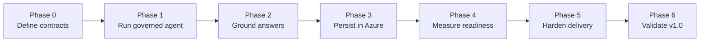
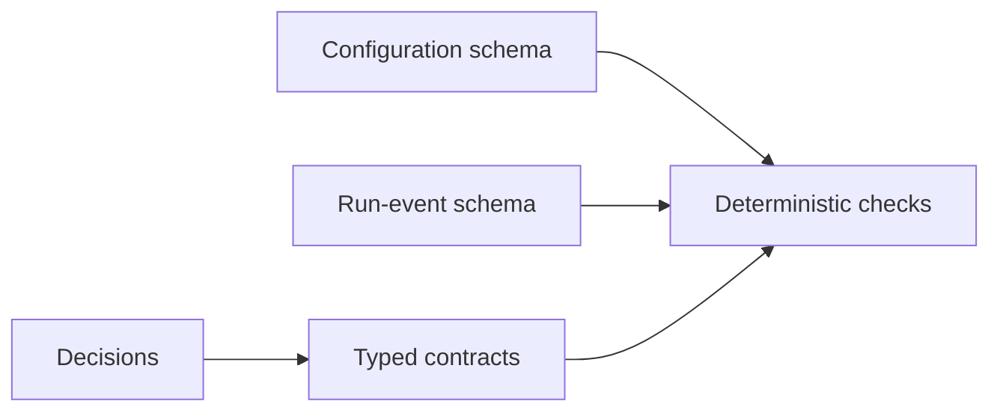
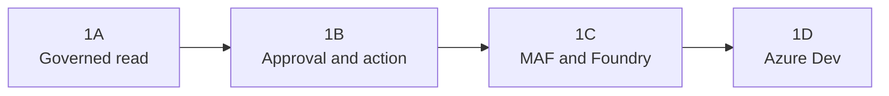
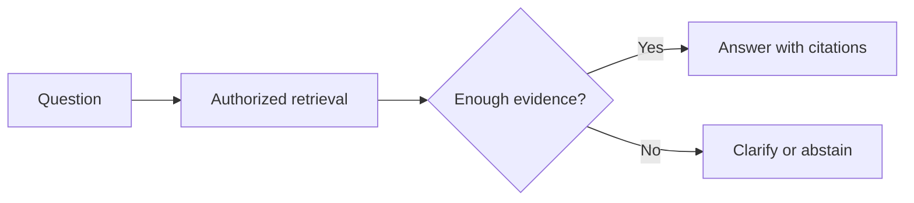
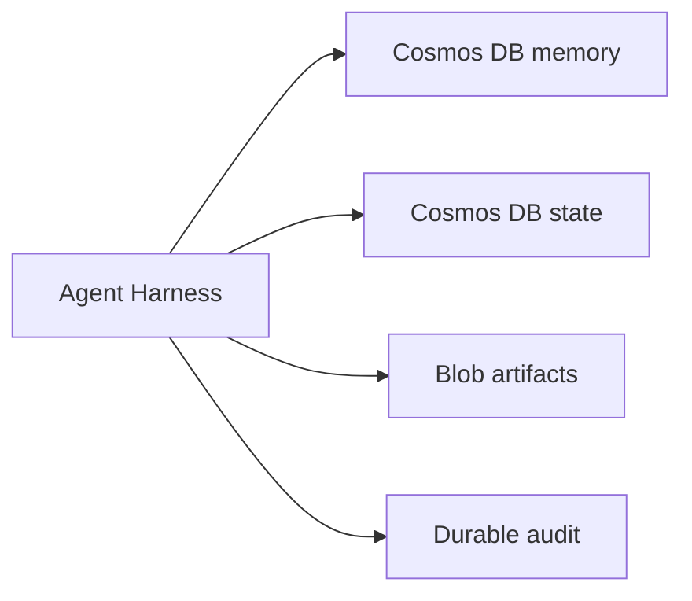
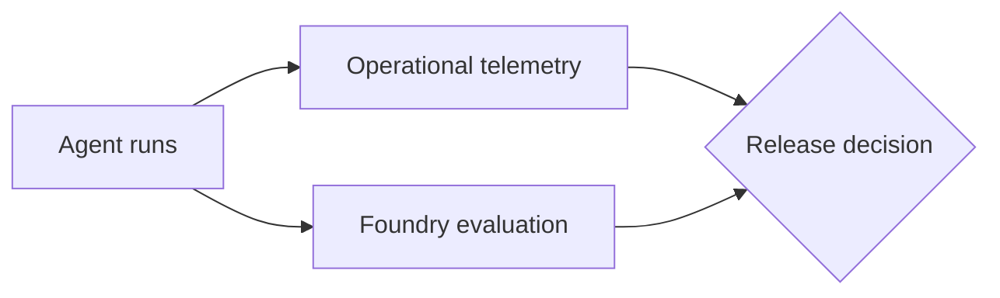
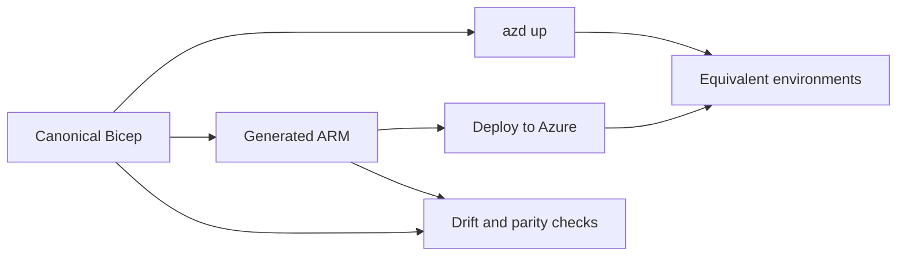
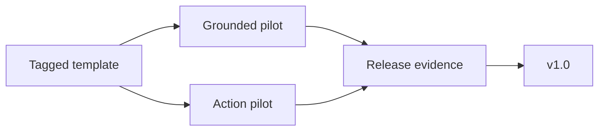

# Implementation Plan

> **Audience:** contributors and maintainers  
> **Status:** current and authoritative  
> **Purpose:** delivery order, current status, and completion evidence

This plan says **what ships when**. The [pattern catalogue](pattern-catalog.md) defines detailed
behavior, and the [adapter contract guide](../architecture/adapter-contracts.md) defines shared
adapter expectations.

## Delivery Rules

- Build thin, testable increments.
- Keep local policy tests independent of Azure.
- Use released MAF capabilities instead of creating another agent runtime.
- Record architecture changes in ADRs.
- Mark a phase complete only when its exit evidence passes.

## Status

| Phase | Outcome | Status |
|---|---|---|
| 0 | Tooling, schemas, contracts, and decisions | Complete |
| 1A | Governance and read path foundation | Complete |
| 1B | Approval and action lifecycle | Complete |
| 1C | MAF and Foundry runtime integration | Complete (approved live-test model exception) |
| 1D | Azure Dev deployment | In progress (hosted smoke passes; local Inspector request operator-confirmed) |
| 2 | Grounded-assistant profile | Not started |
| 3 | Durable Azure adapters | Not started |
| 4 | Evaluation and operations | Not started |
| 5 | Deployment and CI hardening | Not started |
| 6 | Pilots and v1.0 release | Not started |

## Architecture Evolution

Each phase adds one capability layer. Detailed behavior remains authoritative in the
[pattern catalogue](pattern-catalog.md).

### Phase 0: Define the Rules

Phase 0 defines and validates the boundaries before runtime implementation.

### Phase 1: Run the First Governed Agent

Phase 1 proves the local governance lifecycle, then connects and deploys it without changing the
policy envelope.

### Phase 2: Ground Answers

Phase 2 adds evidence retrieval, citations, freshness, and safe insufficient-evidence routes.

### Phase 3: Persist in Azure

Phase 3 replaces in-memory adapters without changing agent policy.

### Phase 4: Measure Readiness

Phase 4 combines service health and agent-quality evidence into one release decision.

### Phase 5: Harden Delivery

Phase 5 makes both deployment paths repeatable and rejects infrastructure drift.

### Phase 6: Validate v1.0

Phase 6 proves that different customer scenarios retain the same governance and evaluation
controls. The complete target is shown in the
[reference architecture](../architecture/overview.md).

## Phase 0: Foundation

Phase 0 established:

- Python 3.12, pinned dependencies, `uv.lock`, and contributor setup.
- Versioned configuration and run-event schemas with three example profiles.
- Framework-neutral types, adapter protocols, and conformance-test design.
- ADRs for MAF, Azure Dev, deployment, state, memory, retrieval, and the reference model.

**Evidence:** dependency setup, schema and contract tests, Pyright, Ruff, and lock validation pass.

## Phase 1: Governed Agent End-to-End Foundation

**Goal:** prove a governed read path and approval-gated action path, compose them through MAF and
Foundry, and deploy the same minimal application to Azure Dev.

### Phase 1A: Governance and Read Path Foundation

**Build**

- Validated YAML configuration and a code-owned registry.
- Tenant, subject, run, trace, permission, and deadline context.
- One typed read tool, execution ceilings, normalized errors, and an in-memory audit sink.
- A local CLI and deterministic policy tests.

**Pattern focus:** [MEM-01](pattern-catalog.md#mem-01),
[STATE-01](pattern-catalog.md#state-01), [SEC-02](pattern-catalog.md#sec-02) to
[SEC-04](pattern-catalog.md#sec-04), [SEC-06](pattern-catalog.md#sec-06),
[POL-01](pattern-catalog.md#pol-01) to [POL-03](pattern-catalog.md#pol-03),
[TOOL-01](pattern-catalog.md#tool-01), [TOOL-04](pattern-catalog.md#tool-04),
[EVAL-01](pattern-catalog.md#eval-01), [OBS-04](pattern-catalog.md#obs-04), and
[OBS-05](pattern-catalog.md#obs-05).

**Exit:** the local read path succeeds; unknown or unauthorized tools fail; identity reaches every
tool and event; audit records contain no prohibited payload; Azure is not required.

**Evidence:** strict profile loading, registry and policy tests, tenant-scoped read execution, safe
four-event audit lifecycle, local CLI, Pyright, Ruff, and deterministic tests pass without Azure.

### Phase 1B: Approval and Action Lifecycle

**Build**

- One proposal tool and one deterministic sample action.
- In-memory run state, checkpoint, approval, artifact handle, and idempotency ledger.
- Approval, denial, expiry, resume, replay, and partial-failure tests.

**Pattern focus:** [STATE-02](pattern-catalog.md#state-02) to
[STATE-05](pattern-catalog.md#state-05), [POL-04](pattern-catalog.md#pol-04),
[POL-05](pattern-catalog.md#pol-05), [POL-07](pattern-catalog.md#pol-07),
[TOOL-02](pattern-catalog.md#tool-02), and [TOOL-03](pattern-catalog.md#tool-03).

**Exit:** an action cannot run before approval; denial and expiry block it; approval resumes once;
replay does not repeat the effect.

**Evidence:** proposal and act-tier tools, in-memory lifecycle adapters, approval-bound resume,
atomic idempotency and audit sequencing, local action CLI, and deterministic denial, expiry,
cross-tenant, mutation, replay, concurrency, and uncertain-outcome tests pass without Azure.

### Phase 1C: MAF and Foundry Runtime Integration

**Build**

- Released MAF Harness composition around the Phase 1A and 1B policy envelope.
- Foundry model adapter with streaming, usage, cancellation, and normalized provider errors.
- Bounded conversation history, source labels, and tracing.

**Pattern focus:** [MEM-02](pattern-catalog.md#mem-02),
[CTX-01](pattern-catalog.md#ctx-01), [CTX-02](pattern-catalog.md#ctx-02),
[CTX-05](pattern-catalog.md#ctx-05), and [OBS-01](pattern-catalog.md#obs-01).

**Exit:** the reference model selects a registered tool through MAF; governance remains code-owned;
model and tool spans share run correlation.

**Evidence (16 October 2026):** the live passwordless CLI selected `get_service_status`, returned
the sample API's healthy status, emitted six audit events, and produced model, tool, and agent spans
sharing one trace ID. The full local suite passed: 56 tests, Pyright, and Ruff. Metadata-only trace
evidence is retained under ignored `.local/logs/phase1c-live-trace.json`.

**Approved exit exception:** the proof used `gpt-5-mini` version `2025-08-07`, GlobalStandard
capacity 1, because quota for the `gpt-5.4-mini` reference baseline was unavailable. This closes the
runtime integration milestone, not reference-model certification. Repeat the live proof with the
[reference model](../decisions/0008-gpt-5-4-mini-reference-model.md) when quota is available.
Application Insights export and managed-identity hosting remain Phase 1D work.

### Phase 1D: Azure Dev Deployment

**Build**

- Preflight for tools, authentication, providers, model availability, and quota.
- Minimal `azure.yaml` and canonical Bicep for hosting, managed identity, Foundry, RBAC, and
  Application Insights.
- Supported Responses HTTP host plus VS Code Agent Inspector configuration and evidence.
- An initial generated **Deploy to Azure** artifact plus cloud smoke and trace checks.

**Pattern focus:** [SEC-01](pattern-catalog.md#sec-01),
[SEC-05](pattern-catalog.md#sec-05), [SEC-07](pattern-catalog.md#sec-07),
[OBS-01](pattern-catalog.md#obs-01), and [OBS-02](pattern-catalog.md#obs-02).

**Exit:** both deployment entry points create the minimal Azure Dev topology; one managed-identity
request completes with correlated traces; local policy tests still require no Azure connection.

**Increment evidence (20 October 2026):** azd, Foundry extensions, and Azure sign-in preflight pass.
The released Responses server now wraps `MafAgentExecutor`; HTTP tests cover registered tools,
concurrent identity isolation, cross-tenant denial, strict input, JSON/SSE output, cancellation audit,
and sanitized provider failures. A real loopback socket returned healthy readiness and a completed
governed sample-tool response. Root VS Code debug/Inspector wiring is present.
Validation passes: 84 deterministic tests, Pyright with zero errors, Ruff lint/format checks,
documentation links, public-only lock consistency, and `git diff --check`.

**Identity increment (20 October 2026):** the hosted factory now enforces a single platform tenant,
an explicit bounded user allowlist, hashed harness subjects, and unambiguous platform headers.
Client-provided tenant and subject claims cannot override that binding. The local authenticator
refuses hosted execution. Tests exercise the adapter and its full HTTP/tool/audit composition;
live ingress authenticity is not yet proven. See
[ADR 0011](../decisions/0011-single-tenant-foundry-ingress-identity.md).

**Container increment (20 October 2026):** the operator selected container deployment to Foundry
Hosted Agents while retaining Python 3.12. A guarded hosted entry point and released MAF middleware
forward the SDK platform call ID per model request without mutating shared client headers.
Concurrent JSON/streaming transport tests and HTTP-to-model tests preserve caller isolation;
hosted credentials exclude developer and client-secret fallbacks. The Dockerfile installs frozen
production dependencies and runs non-root. Canonical Bicep and its generated ARM artifact prepare
a dedicated Basic registry, registry-scoped project image-pull permission, and a Foundry connection
without reprovisioning the existing project/model. See the [Azure Dev guide](../getting-started/azure-dev.md).

**Azure container evidence (20 October 2026):** registry-only azd provisioning succeeded in the
operator-selected existing project resource group. Live checks confirm Basic SKU, disabled admin
credentials/anonymous pull, the Entra registry connection, and registry-scoped project `AcrPull`.
ACR remote build installed the frozen production dependencies and pushed the image successfully.
A separate digest-pinned ACR run proved UID 10001, fail-closed hosted startup without platform
configuration, loopback readiness, and denial of instruction overrides without model access.
129 deterministic tests, Pyright, Ruff, Bicep compilation, server-side ARM validation, azd preview,
and local doctor checks pass. An image smoke test is not a Foundry-hosted identity proof.

**Current Phase 1D state:** hosted agent v6 is active and serves production; JSON, SSE, tool calls and
metadata-only cloud traces are verified. Unauthenticated (401) and instruction-override (400)
requests are rejected. A local Inspector request is operator-confirmed. The account is public
(`publicNetworkAccess=Enabled`), not network-isolated. The agent is a Foundry data-plane resource,
not a native ARM resource, so registration happens outside ARM
([ADR 0016](../decisions/0016-registration-outside-deployment-scripts.md); the ADR 0015 bridge stays
experimental).

**Candidate release evidence (28-29 October 2026):** the endpoint was pinned to v4 before `azd deploy`
(default routing is `@latest`, so a new version would otherwise take traffic immediately). v5
(identical configuration, rebuilt image) could not be smoke-tested because the strict host rejected
the platform `agent_session_id`; the host now accepts and strips only that routing field, with tests
that `conversation`, stored state and overrides stay rejected. v6 passed JSON and SSE through a
version-bound session with connected, payload-free traces, then was promoted at 100% and passed the
same checks on the production path. Streaming sent immediately after another request failed with
`model_provider_error` and passed after a pause. The model deployment (`gpt-5-mini`, GlobalStandard)
had capacity 1, i.e. 1 request and 1,000 tokens per 60 seconds, while one governed tool request
makes two model calls and uses roughly 650-840 tokens. With operator approval its capacity was raised
to 10 (10 requests and 10,000 tokens per minute; model, version, content filter and upgrade policy
unchanged), after which four consecutive production requests (JSON, SSE, JSON, SSE) all completed,
confirming the cause. The provider body is not logged, by design. 230 deterministic tests, Ruff and
Pyright pass.

**Authorization evidence (29 October 2026):** a temporary service principal in the project's tenant
with zero role assignments obtained a token and received 403 from the Foundry endpoint for JSON and
streaming requests. No `harness.http` span was recorded, so the platform rejected it before the
container. The principal and its secret were deleted (verified through Graph). Operator credentials
and tenant policy were not changed. This closes the unauthorized-principal gate; it does not by
itself prove full ingress acceptance (no separate direct-container ingress target was identified).

**Still open:** full ingress acceptance; portal template publication
and CI checks that ARM and `azd` outputs match; distinguishing rate-limit errors from other provider
errors; the loopback
authenticator is not deployable cloud authentication
([ADR 0010](../decisions/0010-stateless-governed-responses-host.md)).

### Phase 1 Boundary

Phase 1 uses in-memory state, memory, artifacts, approval, and audit. It excludes:

- Retrieval, citations, answerability, and advanced context policy — Phase 2.
- Cosmos DB, Blob Storage, and durable Azure adapters — Phase 3.
- Production evaluation, dashboards, and outcome scorecards — Phase 4.
- Full deployment parity, CI federation, private networking, and production overlays — Phase 5.

## Later Phases

| Phase | Deliverable | Exit evidence |
|---|---|---|
| 2: Grounding and context | Azure AI Search ingestion and retrieval, citations, freshness, compaction, episodic-memory policy, and answerability routes | Weak, stale, conflicting, and sufficient evidence follow the correct route |
| 3: Azure reference adapters | Cosmos DB memory and run state, Blob artifacts, Azure cache and audit, retention, and Application Insights export | In-memory and Azure adapters pass the same isolation, concurrency, expiry, deletion, and replay tests |
| 4: Evaluation and operations | Versioned datasets, deterministic and Foundry evaluators, operational SLOs, outcome thresholds, and regression comparison | One go-live report covers policy, quality, safety, latency, cost, and telemetry |
| 5: Deployment and CI hardening | Modular Bicep, workload-identity CI, preflight, cleanup, production guidance, generated ARM, and drift checks | Both deployment paths pass clean-resource-group tests and CI rejects drift |
| 6: Pilots and release | One grounded pilot, one action pilot, tightened defaults, migration guidance, and release evidence | Both pilots deploy from one tag and preserve mandatory controls |

## Deferred

- Semantic and preference-memory Azure implementations.
- Event-sourced reconstruction and hierarchical context.
- Exact-key and semantic response caching.
- Dynamic model/tool routing.
- Multi-agent workflows, background agents, additional runtimes, and additional languages.
- Copilot discovery and conformance work after v1.0.
- Private-networking modules beyond production integration guidance.

## Current Next Step

Continue **Phase 1D**. Registration follows [ADR 0016](../decisions/0016-registration-outside-deployment-scripts.md)
(accepted): provision with either entry point, then `azd deploy` and a candidate-session smoke
test. This was exercised in Azure Dev (v6). The ADR 0015 bridge stays disabled and has not run in
the cloud. Remaining gates:

- Full ingress acceptance (the unauthorized-principal 403 check passed on 29 October 2026).
- Portal template publication and the Deploy to Azure leg of the parity run (same registration and smoke test).
- Ship the distinct retryable `model_rate_limited` error (implemented and tested locally; replaces
  `model_provider_error` for provider throttling) in the next hosted version; model capacity is now 10.
- Least-privilege custom role (project `agents/read` + `agents/write`), only if a managed-identity
  or workload-identity runner is adopted (ADR 0016, Phase 5).
- Evaluation generation (deferred).

Cloud resources, role assignments, publication and endpoint changes each need separate approval.
See [ADR 0009](../decisions/0009-defer-agent-inspector-to-http-host.md) and
[ADR 0010](../decisions/0010-stateless-governed-responses-host.md).

Tool versions and upgrade policy are in the
[toolchain policy](../getting-started/toolchain.md).
