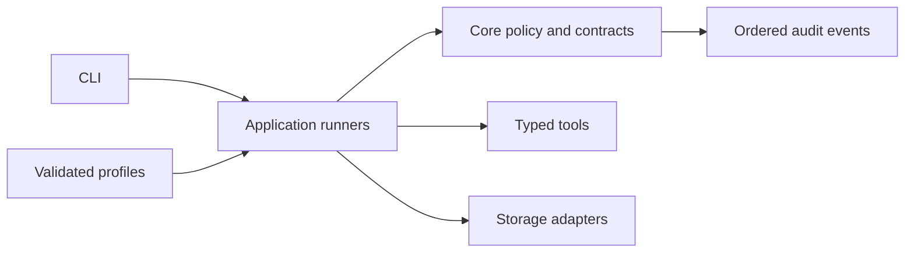
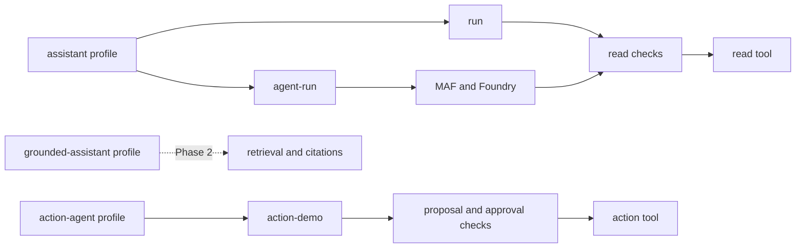

# Developer Code Tour

> **Audience:** developers new to the implementation  
> **Scope:** Phase 1A read, Phase 1B action, Phase 1C MAF, and Phase 1D local HTTP
> **Purpose:** show where code lives and how one request moves through it

## Mental Model



| Area | Owns |
|---|---|
| `core/` | Shared types, contracts, errors, policy, hashes, and event writing |
| `adapters/tools/` | Concrete read, propose, and act tools |
| `adapters/storage/` | In-memory audit and action-lifecycle persistence |
| `app/` | Runnable read and action workflows |
| `config/` | Valid profiles and versioned schemas |
| `tests/` | Executable policy and lifecycle requirements |

The local read and action runners remain deterministic. Phase 1C adds a deterministic MAF
composition test and an environment-configured live Foundry path without making Azure a
prerequisite for policy tests.

## Run It First

The current CLI demonstrates two profile behaviors. The assistant profile has a deterministic
read command and a live MAF/Foundry command. The action-agent profile has a deterministic approval
demo. The grounded-assistant profile is configuration for Phase 2 and is not runnable yet.

Read path:

```powershell
uv run agent-harness run `
  --profile config\profiles\assistant.yaml `
  --tenant tenant-0001 `
  --subject subject-0001
```

Approved action path:

```powershell
uv run agent-harness action-demo `
  --profile config\profiles\action-agent.yaml `
  --tenant tenant-0001 `
  --subject subject-0001 `
  --approver approver-0001 `
  --decision approved
```

Change the decision to `denied` to confirm that the effect count remains zero.

## Key Files

### Core

| File | What it does | Main users |
|---|---|---|
| [`types.py`](../../src/agent_harness/core/types.py) | Defines identity, requests, tools, proposals, approvals, checkpoints, state, and events | All runners and adapters |
| [`contracts.py`](../../src/agent_harness/core/contracts.py) | Defines interfaces that tools, stores, model clients, and exporters must implement | Runners and adapters |
| [`configuration.py`](../../src/agent_harness/core/configuration.py) | Loads YAML, validates JSON Schema, and returns immutable typed settings | CLI composition |
| [`registry.py`](../../src/agent_harness/core/registry.py) | Resolves trusted implementations by explicit name; rejects unknown or duplicate names | Read and action runners |
| [`governance.py`](../../src/agent_harness/core/governance.py) | Checks identity, deadline, permission tier, tool input, and execution limits | Read and action runners |
| [`errors.py`](../../src/agent_harness/core/errors.py) | Provides stable error codes across configuration, policy, audit, and actions | All runtime layers |
| [`action_binding.py`](../../src/agent_harness/core/action_binding.py) | Hashes the exact proposal and derives its idempotency key | Action lifecycle |
| [`event_writer.py`](../../src/agent_harness/core/event_writer.py) | Builds correlated lifecycle events and asks the audit sink to append them in order | Read, action, and MAF executors |

### Adapters

| File | What it does | Replaced later by |
|---|---|---|
| [`service_status.py`](../../src/agent_harness/adapters/tools/service_status.py) | Implements the deterministic tenant-scoped read tool | Customer read tools |
| [`maintenance_request.py`](../../src/agent_harness/adapters/tools/maintenance_request.py) | Implements a proposal tool and an idempotent act-tier sample tool | Customer proposal and action tools |
| [`in_memory_audit.py`](../../src/agent_harness/adapters/storage/in_memory_audit.py) | Validates and stores ordered audit events | Durable audit adapter |
| [`in_memory_action_stores.py`](../../src/agent_harness/adapters/storage/in_memory_action_stores.py) | Stores proposals, artifacts, checkpoints, approvals, run state, and idempotency records | Azure adapters in Phase 3 |
| [`maf/agent_executor.py`](../../src/agent_harness/adapters/maf/agent_executor.py) | Executes released MAF agents with code-owned registry, governance, limits, source labels, audit, and trace correlation | MAF runtime adapter |
| [`foundry/model_client.py`](../../src/agent_harness/adapters/foundry/model_client.py) | Resolves environment references and creates the passwordless, bounded Foundry chat client | Foundry model adapter |

### Phase 1D HTTP Path

```text
POST /responses
  -> code-provided authenticator (never identity from JSON)
  -> strict text-only request and body/output bounds
  -> released Responses server
  -> MafAgentExecutor.run / stream
  -> registered tool -> ReadToolExecutor
  -> correlated audit and terminal JSON / SSE
```

| File | Responsibility |
|---|---|
| [`agent_http_server.py`](../../src/agent_harness/app/agent_http_server.py) | Receives agent requests over HTTP, checks callers and request limits, invokes governed MAF execution, and returns JSON or streamed answers; supports local and Foundry-hosted startup |
| [`request_identity.py`](../../src/agent_harness/adapters/foundry/request_identity.py) | Maps Foundry RBAC-authorized callers into one deployment tenant and hashed subjects; rejects missing or ambiguous platform context |
| [`test_request_identity.py`](../../tests/adapters/foundry/test_request_identity.py) | Proves tenant-bound subject stability, duplicate-header rejection, obsolete-configuration rejection, and resistance to client identity overrides |
| [`telemetry.py`](../../src/agent_harness/adapters/foundry/telemetry.py) | Exports fixed operational span metadata to Application Insights while dropping payloads, raw identity, arbitrary attributes, and exception details |
| [`test_telemetry.py`](../../tests/adapters/foundry/test_telemetry.py) | Injects sensitive span data and verifies that it cannot reach export |
| [`test_agent_http_server.py`](../../tests/app/test_agent_http_server.py) | Proves HTTP tool governance, identity isolation, strict input, streaming, cancellation, and failure privacy using scripted clients |
| [`launch.json`](../../.vscode/launch.json) | Attaches the Python debugger after starting the HTTP host and opening Inspector |
| [`tasks.json`](../../.vscode/tasks.json) | Checks debug ports, starts the repository's Python interpreter, and invokes the VS Code Inspector command |
| [ADR 0010](../decisions/0010-stateless-governed-responses-host.md) | Records the released-SDK choice, stateless subset, privacy overrides, and remaining cloud boundary |

After setting the same Foundry environment references used by `agent-run`:

```powershell
uv run python -m agent_harness.app.agent_http_server --tenant local-tenant --subject local-subject
```

`GET http://127.0.0.1:8088/readiness` reports service health without calling the model.
`POST /responses` accepts `{"input":"Check API status","stream":false}`; use `stream:true` for SSE.
User-message arrays containing text are also supported. Model selection and tools remain code-owned.
Clients cannot supply instructions, system/developer/assistant messages, tool results, identity,
stored-response references, background execution, or persistence.
Foundry adds `agent_reference` routing metadata. The boundary accepts only this harness's
fixed name and an optional numeric version, then strips that metadata before SDK execution.
It does not select the model, tools, or instructions. Foreign references and extra fields fail.

The host defaults `store` to false; requests are capped at 64 KiB and output at 4096 tokens.
Audit remains in memory and therefore is not durable. SDK automatic telemetry configuration is
disabled to avoid its sensitive-content defaults. Hosted packaging explicitly selects
`--telemetry-exporter application-insights`, requiring a deployment connection string.
The metadata-only exporter preserves HTTP/agent/model/tool trace relationships and counts,
not prompts, answers, raw user keys, or exception details. Live cloud ingestion and connected
HTTP/agent/model/tool spans are proven for hosted JSON and streaming requests.

For interactive debugging, press **F5** and select **Harness: Agent HTTP server and Inspector**.
The task uses this repository's virtual environment and fixed sample development identity.
Stop **Harness: Run agent HTTP server** using **Tasks: Terminate Task** after debugging; detaching
the debugger does not terminate the server. A local Inspector service-health request was
operator-confirmed; this is not hosted, debugger or trace-panel validation. Inspector requests for
unsupported history, tools or persistence are rejected explicitly.

### Deployment bridge (optional, deployment-time only)

**Why it exists:** creating a container registry does not tell Foundry which container to run.
`azd` already performs that registration. The optional bridge adds it to the ARM/Deploy to Azure
path; it does not build the container or answer user requests.

**Inputs:** an existing container image identified by its SHA-256 digest, the target Foundry
project, and an existing managed identity with registration permission.

**When explicitly enabled, it runs this sequence:**

| Step / file | What it does |
|---|---|
| 1. [registration.bicep](../../infra/registration.bicep) | ARM starts a temporary deployment script using the supplied identity. |
| 2. [register-agent.sh](../../infra/scripts/register-agent.sh) | Verifies the packaged Python code, installs locked dependencies, then starts the CLI with a timeout. |
| 3. [register_hosted_agent.py](../../src/agent_harness/app/register_hosted_agent.py) | Reads the image/project settings and signs in using managed identity, without a password. |
| 4. [deployment.py](../../src/agent_harness/adapters/foundry/deployment.py) | Validates those settings and builds the Foundry API request describing the container to run. |
| 5. [registration.py](../../src/agent_harness/adapters/foundry/registration.py) | Finds an identical agent version or requests one new version, waits for `active`, and returns its version number and image. |

**Traffic:** if version 4 serves users, registering version 5 leaves users on version 4.
Switching traffic requires a separate step. A first deployment has no old version to protect,
so it requires explicit approval for possible immediate exposure. `active` is not a passed smoke test.

Before deployment, [package_registration.py](../../src/agent_harness/app/package_registration.py)
packages the runner code, not the container image. [Deployment tests](../../tests/deployment)
and [CI](../../.github/workflows/deployment-parity.yml) check the runner and generated assets.

**Status:** disabled by default; do not enable alongside `azd` registration. Cloud validation is
blocked by deployment-script storage authentication (`KeyBasedAuthenticationNotPermitted`).
Design: [ADR 0015](../decisions/0015-passwordless-hosted-deployment-bridge.md).
Configuration: [Azure Dev guide](azure-dev.md#registration-bridge-optional-disabled-by-default).

The default executable mode binds only to loopback. Its fixed development identity must not be used as Azure
authentication; composing it in a Foundry-hosted environment now fails explicitly.

`create_foundry_responses_host` selects `FoundryIngressIdentity` instead. It requires the hosted
environment marker and a valid platform agent tenant UUID. Foundry endpoint RBAC authorizes
callers, including effective inherited roles; there is no application named-user allowlist.
Obsolete `HARNESS_ALLOWED_FOUNDRY_USERS` settings fail startup. A request must carry exactly one
platform user key and call ID, producing a tenant-bound hashed subject. Raw user keys and call
IDs are not written into harness audit. See [ADR 0013](../decisions/0013-foundry-rbac-ingress-authorization.md).

This is not general-purpose HTTP authentication. It relies on Foundry's isolated authenticated
ingress; setting an environment variable or adding headers is not proof of caller authenticity.
The `--hosted` mode validates this identity configuration before creating a model client, rejects
local tenant/subject arguments, and binds port 8088 on all container interfaces. It closes the model
and project clients and credential when the server stops. Do not run this mode outside Foundry's
authenticated ingress.

The hosted model client composes released MAF chat middleware. It reads the SDK's request context
and forwards only `x-agent-foundry-call-id` through per-call `extra_headers`, never shared defaults.
Missing or malformed context fails before sending a model request. Transport tests cover concurrent
JSON and streaming calls, and HTTP tests prove SDK ingress context reaches the outbound model
request without raw user keys or audit leakage. Hosted credentials exclude client-secret and
developer-login providers while retaining platform managed/workload identity discovery.

The [Dockerfile](../../Dockerfile) packages Python 3.12 and frozen production dependencies, uses a
non-root user, and starts this hosted mode. The
[Azure Dev guide](azure-dev.md) describes the registry infrastructure and remaining live gates.
See [ADR 0011](../decisions/0011-single-tenant-foundry-ingress-identity.md).

## How Profiles Map to the Current Application

A **profile is a policy preset**, not a separate program. It sets limits and permitted
capabilities. A **CLI command is a runnable demonstration** that chooses the tools and runners.
The **runner** enforces the safety rules.

The repository contains three profiles, but it does not yet contain three complete runnable
agents:

| Profile | Current command | Status | What it proves |
|---|---|---|---|
| [`assistant.yaml`](../../config/profiles/assistant.yaml) | `run` | Runnable without Azure | A read-only tool is checked, executed, and audited deterministically |
| [`assistant.yaml`](../../config/profiles/assistant.yaml) | `agent-run` | Runnable when Foundry access is available | The Foundry model can request the same read tool through MAF, but the same checks still apply |
| [`grounded-assistant.yaml`](../../config/profiles/grounded-assistant.yaml) | None yet | Planned for Phase 2 | Azure AI Search retrieval, citations, and answerability are not implemented yet |
| [`action-agent.yaml`](../../config/profiles/action-agent.yaml) | `action-demo` | Runnable without Azure | An action cannot execute until its exact proposal is approved, and it executes at most once |

The CLI rejects unsupported profile and command combinations. In particular, it rejects the
grounded profile instead of silently producing an ungrounded answer.



### What Each Path Means

**Read Path**

- Selected by `assistant.yaml + run`.
- Calls a known read-only tool directly; no AI model is involved.
- Exists so identity, permission, input, limits, and audit behavior can be tested quickly and
  deterministically.

**MAF and Foundry Path**

- Selected by `assistant.yaml + agent-run`.
- MAF is the agent runtime library that manages the conversation and tool-request loop.
- Foundry hosts the AI model that answers the question or requests an allowed tool.
- If the model requests a tool, the request enters the same Read Path checks before execution.
- Exists to prove that adding an AI model does not bypass the deterministic safety controls.

**Action Path**

- Selected by `action-agent.yaml + action-demo`.
- Handles a state-changing tool through proposal, human decision, and one-time execution.
- Exists because a permission check alone is not enough for consequential actions: the exact
  change must be approved, unchanged, unexpired, and protected from duplicate execution.

The grounded path does not exist yet. `grounded-assistant.yaml` describes the required Phase 2
policy, but retrieval, citations, and answerability must be implemented before that profile can
run.

### Files Used by Each Path

| Path | Main files | Responsibility |
|---|---|---|
| Read Path | [`cli.py`](../../src/agent_harness/app/cli.py), [`read_executor.py`](../../src/agent_harness/app/read_executor.py), [`service_status.py`](../../src/agent_harness/adapters/tools/service_status.py) | The CLI selects the assistant profile, the executor enforces read checks, and the sample tool returns tenant-scoped data |
| MAF and Foundry Path | [`cli.py`](../../src/agent_harness/app/cli.py), [`maf/agent_executor.py`](../../src/agent_harness/adapters/maf/agent_executor.py), [`foundry/model_client.py`](../../src/agent_harness/adapters/foundry/model_client.py), [`read_executor.py`](../../src/agent_harness/app/read_executor.py) | The CLI creates the live client, MAF manages model interaction, Foundry supplies the model, and read-tool requests still use the governed executor |
| Action Path | [`cli.py`](../../src/agent_harness/app/cli.py), [`action_lifecycle.py`](../../src/agent_harness/app/action_lifecycle.py), [`maintenance_request.py`](../../src/agent_harness/adapters/tools/maintenance_request.py), [`in_memory_action_stores.py`](../../src/agent_harness/adapters/storage/in_memory_action_stores.py) | The CLI starts the demo, the lifecycle coordinates proposal/decision/resume, the tool performs the approved effect, and storage retains lifecycle state |

The application files are reusable safety mechanisms, not one file per profile.

For action execution, `propose` saves the exact requested change, `decide` only records the
approver's decision, and `resume` verifies that approval before executing once. See
[`test_read_executor.py`](../../tests/app/test_read_executor.py),
[`test_agent_executor.py`](../../tests/adapters/maf/test_agent_executor.py), and
[`test_action_lifecycle.py`](../../tests/app/test_action_lifecycle.py) for the executable behavior.

## Configuration Flow

1. The CLI receives a profile path.
2. [`configuration.py`](../../src/agent_harness/core/configuration.py) validates it against
   [`harness.schema.json`](../../config/schema/v1/harness.schema.json).
3. Typed settings select limits and permission tier.
4. The CLI verifies that the command supports the selected profile.
5. Code registers known tools and adapters.
6. Unknown names, unsupported pairings, or invalid settings fail before execution.

Example profiles:

- [`assistant.yaml`](../../config/profiles/assistant.yaml)
- [`grounded-assistant.yaml`](../../config/profiles/grounded-assistant.yaml)
- [`action-agent.yaml`](../../config/profiles/action-agent.yaml)

Configuration selects registered behavior; it cannot import arbitrary code or disable mandatory
controls.

## Safety Rules to Preserve

- Identity and tenant scope reach every tool, state record, and event.
- Retrieved content and tool output remain untrusted data.
- Act-tier tools require approval bound to the exact proposal digest.
- Changed or expired proposals cannot execute.
- Idempotency prevents repeated effects.
- Unknown action outcomes block automatic retry.
- Audit events contain identifiers and decisions, not raw business payloads.
- Every run remains bounded by tool-call, step, and deadline limits.

## Tests as Executable Documentation

| Test | Read it when changing |
|---|---|
| [`test_configuration.py`](../../tests/core/test_configuration.py) | Profile loading |
| [`test_governance.py`](../../tests/core/test_governance.py) | Identity, tiers, limits, or audit policy |
| [`test_event_writer.py`](../../tests/core/test_event_writer.py) | Event ordering or concurrency |
| [`test_action_binding.py`](../../tests/core/test_action_binding.py) | Proposal hashes or idempotency keys |
| [`test_read_executor.py`](../../tests/app/test_read_executor.py) | Read lifecycle |
| [`test_action_lifecycle.py`](../../tests/app/test_action_lifecycle.py) | Approval and action lifecycle |
| [`test_cli.py`](../../tests/app/test_cli.py) | Application composition |
| [`test_agent_executor.py`](../../tests/adapters/maf/test_agent_executor.py) | MAF tool selection, source labels, trace correlation, failure normalization, cancellation, and act-tier fail-closed behavior |
| [`test_model_client.py`](../../tests/adapters/foundry/test_model_client.py) | Foundry environment validation and code-owned invocation ceilings |
| [`test_schemas.py`](../../tests/schema/test_schemas.py) | Configuration or event schemas |

## Common Extension Paths

### Add a read tool

1. Implement the `Tool` contract with `risk_tier=read`.
2. Register it in application composition.
3. Add schema, tenant-isolation, and safe-audit tests.

### Add an action tool

1. Implement separate propose-tier and act-tier surfaces.
2. Route proposals through `ActionLifecycle`.
3. Require the supplied idempotency key in the act tool.
4. Test denial, expiry, mutation, replay, concurrency, and unknown outcomes.

### Add a storage adapter

1. Implement the relevant contract from `contracts.py`.
2. Preserve exact tenant and subject scope.
3. Preserve optimistic concurrency, expiry, and error semantics.
4. Run the same conformance behavior as the in-memory adapter.

## Keeping This Tour Current

Update this page whenever a phase adds a major runtime path, adapter boundary, or application entry
point. Keep details in source and tests; keep this page focused on navigation and end-to-end flow.
