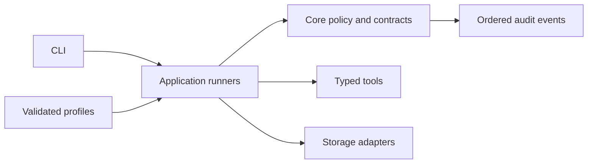
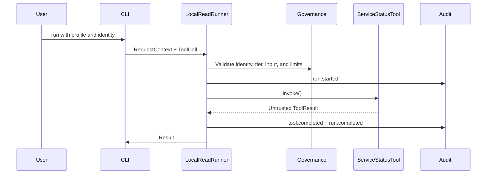
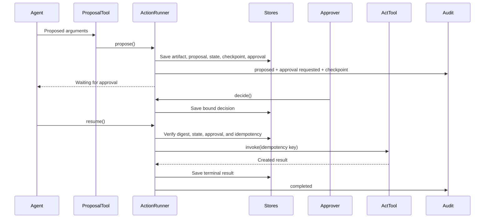

# Developer Code Tour

> **Audience:** developers new to the implementation  
> **Scope:** Phase 1A read path and Phase 1B action path  
> **Purpose:** show where code lives and how one request moves through it

## Mental Model



| Area | Owns |
|---|---|
| `core/` | Shared types, contracts, errors, policy, hashes, and event writing |
| `adapters/tools/` | Concrete read, propose, and act tools |
| `adapters/storage/` | In-memory audit and action-lifecycle persistence |
| `app/` | Runnable read and action workflows |
| `config/` | Valid profiles and versioned schemas |
| `tests/` | Executable policy and lifecycle requirements |

The current runners are deterministic and local. MAF and Foundry integration begins in Phase 1C.

## Run It First

Read path:

```powershell
uv run agent-harness run `
  --profile config\profiles\assistant.yaml `
  --tenant tenant-0001 `
  --subject subject-0001
```

Approved action path:

```powershell
uv run agent-harness action-demo `
  --profile config\profiles\action-agent.yaml `
  --tenant tenant-0001 `
  --subject subject-0001 `
  --approver approver-0001 `
  --decision approved
```

Change the decision to `denied` to confirm that the effect count remains zero.

## Key Files

### Core

| File | What it does | Main users |
|---|---|---|
| [`types.py`](../../src/agent_harness/core/types.py) | Defines identity, requests, tools, proposals, approvals, checkpoints, state, and events | All runners and adapters |
| [`contracts.py`](../../src/agent_harness/core/contracts.py) | Defines interfaces that tools, stores, model clients, and exporters must implement | Runners and adapters |
| [`configuration.py`](../../src/agent_harness/core/configuration.py) | Loads YAML, validates JSON Schema, and returns immutable typed settings | CLI composition |
| [`registry.py`](../../src/agent_harness/core/registry.py) | Resolves trusted implementations by explicit name; rejects unknown or duplicate names | Read and action runners |
| [`governance.py`](../../src/agent_harness/core/governance.py) | Checks identity, deadline, permission tier, tool input, and execution limits | Read and action runners |
| [`errors.py`](../../src/agent_harness/core/errors.py) | Provides stable error codes across configuration, policy, audit, and actions | All runtime layers |
| [`action.py`](../../src/agent_harness/core/action.py) | Hashes the exact proposal and derives its idempotency key | Action runner |
| [`events.py`](../../src/agent_harness/core/events.py) | Builds correlated lifecycle events and asks the audit sink to append them in order | Read and action runners |

### Adapters

| File | What it does | Replaced later by |
|---|---|---|
| [`service_status.py`](../../src/agent_harness/adapters/tools/service_status.py) | Implements the deterministic tenant-scoped read tool | Customer read tools |
| [`maintenance_request.py`](../../src/agent_harness/adapters/tools/maintenance_request.py) | Implements a proposal tool and an idempotent act-tier sample tool | Customer proposal and action tools |
| [`in_memory_audit.py`](../../src/agent_harness/adapters/storage/in_memory_audit.py) | Validates and stores ordered audit events | Durable audit adapter |
| [`in_memory_action.py`](../../src/agent_harness/adapters/storage/in_memory_action.py) | Stores proposals, artifacts, checkpoints, approvals, run state, and idempotency records | Azure adapters in Phase 3 |

### Application

| File | What it does |
|---|---|
| [`local_runner.py`](../../src/agent_harness/app/local_runner.py) | Runs one governed read tool and records its lifecycle |
| [`action_runner.py`](../../src/agent_harness/app/action_runner.py) | Coordinates propose, decide, resume, execute-once, and failure handling |
| [`cli.py`](../../src/agent_harness/app/cli.py) | Composes local dependencies for the `run` and `action-demo` commands |

## Read Path



Start with [`test_local_runner.py`](../../tests/app/test_local_runner.py) to see successful,
unknown-tool, and cross-tenant examples.

## Action Path



The important separation is:

```text
Model or caller proposes
Human approves
Harness authorizes and resumes
Act tool performs the effect once
```

[`test_action_runner.py`](../../tests/app/test_action_runner.py) demonstrates approval, denial,
expiry, tenant isolation, changed proposals, stale checkpoints, replay, concurrency, and unknown
outcomes.

## Configuration Flow

1. The CLI receives a profile path.
2. [`configuration.py`](../../src/agent_harness/core/configuration.py) validates it against
   [`harness.schema.json`](../../config/schema/v1/harness.schema.json).
3. Typed settings select limits and permission tier.
4. Code registers known tools and adapters.
5. Unknown names or invalid settings fail before execution.

Example profiles:

- [`assistant.yaml`](../../config/profiles/assistant.yaml)
- [`grounded-assistant.yaml`](../../config/profiles/grounded-assistant.yaml)
- [`action-agent.yaml`](../../config/profiles/action-agent.yaml)

Configuration selects registered behavior; it cannot import arbitrary code or disable mandatory
controls.

## Safety Rules to Preserve

- Identity and tenant scope reach every tool, state record, and event.
- Retrieved content and tool output remain untrusted data.
- Act-tier tools require approval bound to the exact proposal digest.
- Changed or expired proposals cannot execute.
- Idempotency prevents repeated effects.
- Unknown action outcomes block automatic retry.
- Audit events contain identifiers and decisions, not raw business payloads.
- Every run remains bounded by tool-call, step, and deadline limits.

## Tests as Executable Documentation

| Test | Read it when changing |
|---|---|
| [`test_configuration.py`](../../tests/core/test_configuration.py) | Profile loading |
| [`test_governance.py`](../../tests/core/test_governance.py) | Identity, tiers, limits, or audit policy |
| [`test_events.py`](../../tests/core/test_events.py) | Event ordering or concurrency |
| [`test_action.py`](../../tests/core/test_action.py) | Proposal hashes or idempotency keys |
| [`test_local_runner.py`](../../tests/app/test_local_runner.py) | Read lifecycle |
| [`test_action_runner.py`](../../tests/app/test_action_runner.py) | Approval and action lifecycle |
| [`test_cli.py`](../../tests/app/test_cli.py) | Application composition |
| [`test_schemas.py`](../../tests/schema/test_schemas.py) | Configuration or event schemas |

## Common Extension Paths

### Add a read tool

1. Implement the `Tool` contract with `risk_tier=read`.
2. Register it in application composition.
3. Add schema, tenant-isolation, and safe-audit tests.

### Add an action tool

1. Implement separate propose-tier and act-tier surfaces.
2. Route proposals through `ActionRunner`.
3. Require the supplied idempotency key in the act tool.
4. Test denial, expiry, mutation, replay, concurrency, and unknown outcomes.

### Add a storage adapter

1. Implement the relevant contract from `contracts.py`.
2. Preserve exact tenant and subject scope.
3. Preserve optimistic concurrency, expiry, and error semantics.
4. Run the same conformance behavior as the in-memory adapter.

## Keeping This Tour Current

Update this page whenever a phase adds a major runtime path, adapter boundary, or application entry
point. Keep details in source and tests; keep this page focused on navigation and end-to-end flow.
